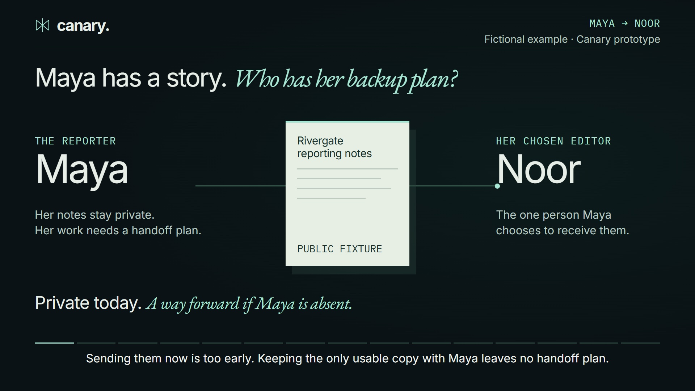
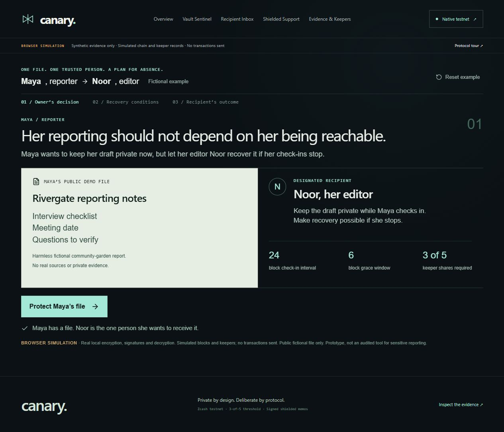
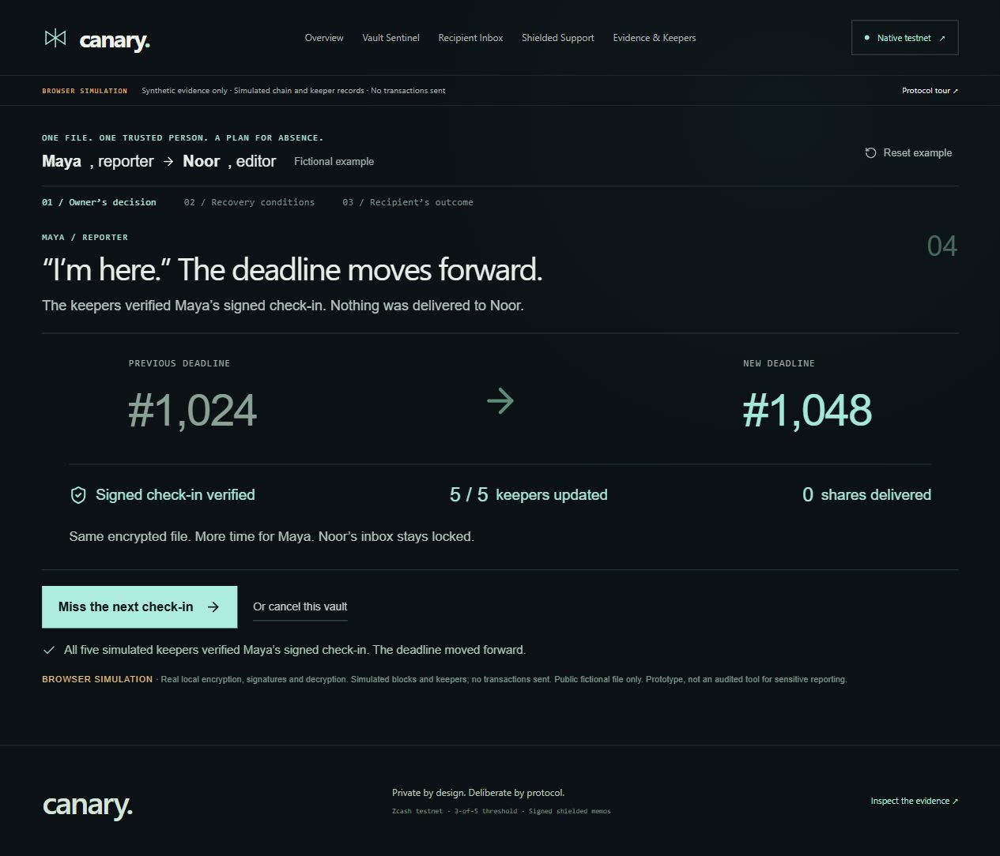
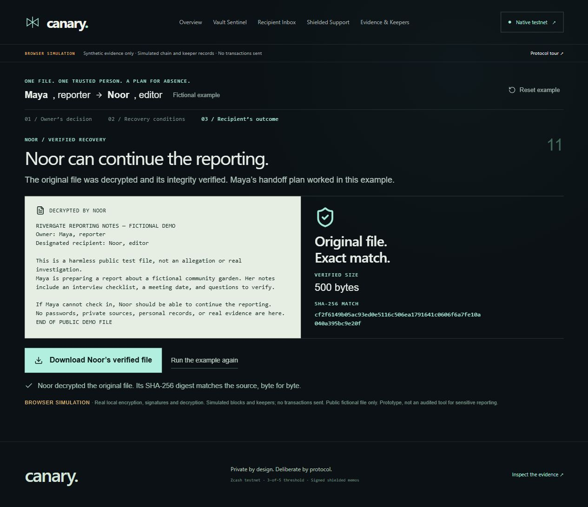
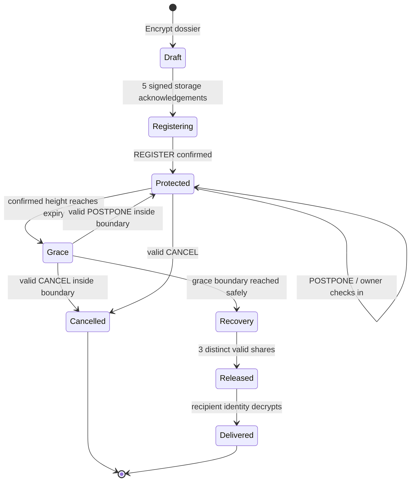
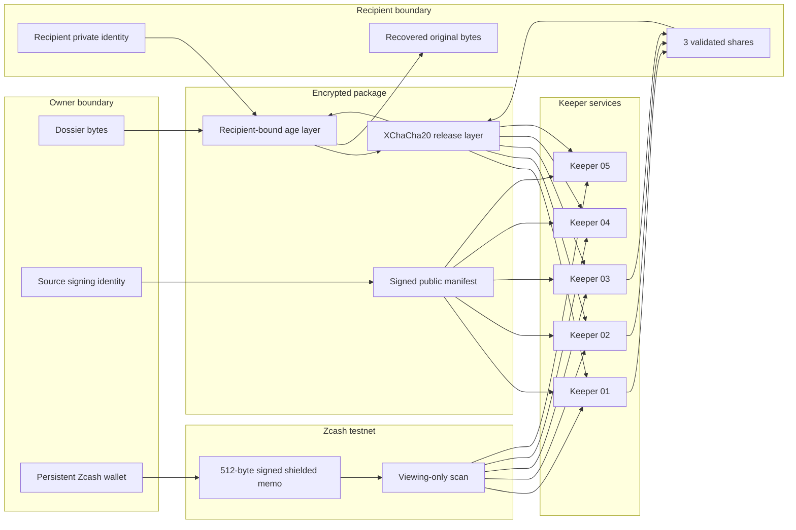

# Canary

## Keep it private now. Make it recoverable if you stop checking in.

**Canary helps a journalist leave an encrypted reporting dossier for a trusted editor—without handing over access immediately.** The journalist checks in to keep the handoff on hold. If check-ins stop, a deadline and grace period pass, and enough keepers participate, the chosen editor can recover the file using their own private key.

It is a contingency plan for the work: **“If I become unavailable, this is who should be able to continue.”**

> **Current status:** a working, tested prototype with a browser simulation and a verified Zcash testnet path. Use synthetic files to explore it. It has not been independently security-audited and is not ready for real sensitive reporting.

<p align="center">
  <a href="https://unspecifiedcoder.github.io/z-canary/"></a>
</p>

<p align="center">
  
  
  
  
  
</p>

---

## A concrete example: Maya's reporting, Noor's next step

*Maya and Noor are fictional people. Their dossier is a synthetic demonstration file.*

Maya is preparing a story. Her editor, Noor, may need the supporting notes if Maya becomes unavailable, but Maya is not ready to grant access today. Sending the file now is too early. Keeping the only usable copy with Maya leaves no handoff plan.

With Canary, Maya:

1. **Protects the dossier.** She encrypts the file for Noor and sets a check-in deadline and grace window.
2. **Keeps control while present.** A signed check-in extends the deadline. A valid cancellation before release stops future share delivery.
3. **Prepares a recovery path.** If the deadline and grace window pass without a valid check-in, keepers evaluate the confirmed record. Noor needs three valid keeper shares **and** Noor's own private key to recover the file.

A **keeper** is a service that holds one piece of the release key and checks whether release is permitted. One keeper cannot unlock the release layer alone. The demonstrated configuration requires **3 of 5**.

**The result is a recoverable file in the recipient workflow.** Canary does not automatically email the dossier, publish a story, or decide whether Maya is safe. It responds to the check-in record.

## Watch the complete example

[](https://unspecifiedcoder.github.io/z-canary/)

**[Explore the live experience](https://unspecifiedcoder.github.io/z-canary/)** · **[Watch the narrated demo · 3:12](https://unspecifiedcoder.github.io/z-canary/#watch)** · **[Try the example yourself](https://unspecifiedcoder.github.io/z-canary/app/#maya-noor)**

The live experience now uses an original sealed-dossier identity and a redesigned Maya → Keepers → Noor walkthrough. The film records the previous interface; its actions and recovery rules remain the same.

Follow Maya from protecting a synthetic dossier to checking in, cancelling, missing a deadline, and Noor's permitted recovery. The film uses captured application steps, edited for time: a changed deadline, a rejected early attempt, a cancelled vault, stale scans, too few shares, a wrong recipient key, and the original file recovered. Browser simulation and recorded native testnet proof are explicitly labeled.

## What happens in each scenario?

| What happens | What Canary does | What Noor can do |
|---|---|---|
| Maya checks in on time | Applies the valid signed command and extends the deadline. | Wait; normal release remains locked. |
| Noor tries to open the dossier early | Refuses recovery without enough permitted release shares. | Cannot open it with the recipient key alone. |
| Maya misses the deadline | Enters a grace window; expiry alone does not release the file. | Wait while keepers evaluate on-time commands. |
| Maya checks in during grace | A valid command included within the allowed boundary extends the deadline. | Wait; the recovery path is deferred. |
| Maya cancels before release | A valid cancellation stops future share delivery. | Cannot recover through that cancelled release path. |
| A keeper has stale or incomplete chain data | Suspends that keeper's release decision until its view is healthy. | Cannot treat missing information as permission. |
| Only two valid shares are available | Keeps threshold recovery blocked. | Wait for a third valid, distinct share. |
| Conditions pass and three valid shares arrive | Allows reconstruction of the release key. | Use Noor's private key, decrypt, verify, and download the original file. |
| Someone has shares but lacks Noor's private key | The recipient encryption layer remains locked. | Shares alone are insufficient. |

Cancellation cannot recall shares already delivered. Three colluding keepers could release early to the designated recipient. These are real trust boundaries, not problems hidden by the demo.

## Try it in the app

<p align="center">
  
</p>

<table>
  <tr>
    <td width="50%"></td>
    <td width="50%"></td>
  </tr>
  <tr>
    <td align="center"><sub>Maya checks in · deadline moves from 1,024 to 1,048</sub></td>
    <td align="center"><sub>Noor decrypts · original 500-byte file verified</sub></td>
  </tr>
</table>

Start with **[Try the example](https://unspecifiedcoder.github.io/z-canary/app/#maya-noor)**. You take the actions yourself: protect Maya's file, try Noor's inbox too early, check in, explore cancellation, and work through the missed-check-in recovery path. The result panels show what actually changed after each action.

The app also includes the **Living Vault**, the original six-chapter protocol guide, owner controls, recipient inbox, shielded support, keeper topology, evidence management, and a connected native workspace. It supports reduced motion, bounded WebGL resolution, hidden-tab pausing, and a labeled 2D fallback.

[Run the browser demo](#run-the-guided-experience) · [Inspect the testnet proof](#a-real-testnet-proof) · [Read the trust limits](#threat-model-and-honest-limits)

## What works today?

| Experience | What you can verify | What is simulated or limited |
|---|---|---|
| **Browser demonstration** | File encryption, signed commands, check-in and cancellation behavior, threshold recovery, and exact-byte verification. | Blocks, transactions, keeper records, and timing are simulated in one browser. No wallet or real transaction is needed. |
| **Native Zcash testnet** | Actual shielded transactions, persistent encrypted storage, five keeper processes, and recipient recovery of the original test file. | The five keeper services share one local operator and scanner. They are not five independent organizations. Native mode currently targets Windows. |

The browser's encryption format is separate from the native format. Test results and recorded transactions are linked below so a reviewer can inspect the implementation, not just watch an animation.

### Why Zcash is part of it

In native mode, Maya's signed check-ins and cancellation commands travel in shielded Zcash memos. The dossier itself stays off-chain and encrypted. Keepers use confirmed commands to decide whether to keep waiting or permit release. **No smart contract is deployed.** This transport choice does not establish a guarantee of network anonymity.

<details>
<summary><strong>Technical walkthrough: lifecycle, architecture, and security boundaries</strong></summary>

## Lifecycle



The implementation fails closed when the scanner is stale, incomplete, or detects a confirmed-chain discontinuity. It does not automatically recover a deep reorganization; an operator must resolve it.

## Architecture



### What crosses each boundary

| Boundary | Allowed | Never required there |
|---|---|---|
| Browser scene | Public lifecycle projection, keeper availability, countdown | Filenames, plaintext, private keys, share bytes, bearer token |
| Zcash chain | Signed command type, sequence, expiry, manifest commitment | Dossier bytes, filename, recipient private identity |
| Keeper | Its encrypted envelope, manifest, confirmed command stream | Recipient private identity, complete release key before threshold |
| Recipient | Encrypted package, validated release shares | Source signing key, wallet spending key |

</details>

## A real testnet proof

The completed native acceptance run used four shielded transactions and recovered the exact fixture after threshold release. Links below open in the Zcash testnet explorer.

| Action | Block | Transaction |
|---|---:|---|
| Register release-path vault | 4,546,656 | [`1d479796…19cf90ecb`](https://zexplorer.app/testnet/tx/1d4797966b97aac313b4ce7db58a4e546593c1e5efacfa992b3c73519cf90ecb) |
| Register cancellation-path vault | 4,546,660 | [`35bfb606…ecd56be0`](https://zexplorer.app/testnet/tx/35bfb606f1e822215e5827dafc6f788319d798cb96fa14f368dedcdfecd56be0) |
| Check in / postpone | 4,546,671 | [`60d30eb1…9a002f66`](https://zexplorer.app/testnet/tx/60d30eb17342311926d39c94164393d0ce9042bb3fe5e1bb3c3311d19a002f66) |
| Cancel | 4,546,677 | [`32e76a24…fbe1d865`](https://zexplorer.app/testnet/tx/32e76a242961415eee02df615778d8ab0f26427256c47bcdf258e661fbe1d865) |

All five keeper databases applied the check-in at sequence 1. The cancelled vault delivered zero shares. The release-path vault produced five validated shares and recovered the original 136-byte fixture with SHA-256 `e05e833a180c72954315c0165cf79dc921221065f65263b408bcf99ba362d2d2`.

The full reproducible record is in [docs/evidence/VERIFICATION.md](docs/evidence/VERIFICATION.md).

## Run the guided experience

Requirements: Node.js **22.12+** and npm.

```bash
git clone https://github.com/unspecifiedcoder/z-canary.git
cd z-canary
npm ci --legacy-peer-deps
npm test
npm run typecheck
npm run dev
```

Open `http://127.0.0.1:3000` and choose **Try Maya & Noor's story**. The example supplies a fictional reporting file and runs real browser encryption, signed commands, threshold checks, and decryption against simulated chain and keeper records. It is repeatable and resettable; it never connects to a wallet or sends a transaction. Use **Vault Sentinel** for additional owner actions, **Recipient Inbox** for recovery, and **Evidence & Keepers** to inspect keeper participation.

The verified Maya/Noor browser run recovered the original **500-byte** `Maya-Rivergate-demo-notes.txt` file. Its SHA-256 is `cf2f6149b05ac93ed0e5116c506ea1791641c0606f6a7fe10a040a395bc9e20f`. This is separate from the **136-byte native testnet fixture** above. [Case-study tests](tests/caseStudy.test.ts) cover the complete recovery path, signed cancellation, check-in during grace, and clean reset.

For a production bundle:

```bash
npm run build
npm run preview -- --host 127.0.0.1 --port 4174
```

## Run the local keeper rehearsal

The Rust workspace can run five actual keeper processes against a clearly labeled synthetic chain feed:

```bash
npm run demo:keepers
```

This exercises signed provisioning acknowledgements, grace-boundary cancellation, check-in during grace, restart suspension, incomplete-scan rejection, two-share failure, and exact recovery with three shares while two keepers are offline.

The backend uses Rust **1.99.0** as pinned in [backend/rust-toolchain.toml](backend/rust-toolchain.toml). To run its tests directly:

```bash
cargo +1.99.0 test --locked --manifest-path backend/Cargo.toml
```

## Run native Zcash testnet

Native mode currently targets Windows because local identities and wallet recovery use CurrentUser DPAPI. It requires PowerShell 7.2+, Rust 1.99.0, Visual C++ Build Tools, the Windows SDK, and an existing funded testnet wallet state.

First prepare the pinned upstream wallet dependency:

```powershell
pwsh -File backend/scripts/setup-wallet.ps1
```

Then start the authenticated agent and five keeper services:

```powershell
pwsh -File backend/scripts/run-native.ps1 `
  -WalletStateDir 'C:\absolute\path\to\existing-wallet-state' `
  -AllowedOrigin 'http://127.0.0.1:3000'
```

The runner prints the path of a private bearer-token file, never the token itself. Enter the token in the **Native Testnet** screen. It remains in browser memory. The runner refuses to invent or fund a replacement wallet.

Read [backend/README.md](backend/README.md) before native use. It documents the exact setup, state layout, retry behavior, key backups, API, smoke commands, and operational limits.

<details>
<summary><strong>Implementation reference: cryptography, command format, and repository map</strong></summary>

## Cryptographic model

### Native package

1. The source encrypts the dossier to the recipient's age/X25519 identity.
2. A fresh 256-bit release key wraps that ciphertext with XChaCha20-Poly1305.
3. `vsss-rs` splits the release key into a 3-of-5 Shamir sharing.
4. Each keeper receives a distinct, authenticated encrypted envelope.
5. The source signs the canonical manifest and every fixed-size command with Ed25519.
6. Recovery validates context, epoch, keeper identity, index, commitment, and uniqueness before interpolation.
7. The recipient uses their private age identity only after the release layer opens.

### Browser demonstration

The browser uses an intentionally separate `ZCAN-DEMO-X25519-AES256GCM-V2` format with X25519 + HKDF-SHA-256 + AES-256-GCM. Its synthetic actors and in-memory keys exist only to explain the protocol. Do not place sensitive evidence in guided mode.

## Command protocol

Every control command occupies one ZIP-302-compatible 512-byte memo. The signed body binds:

```text
domain | version | network | operation | switch_id | sequence
       | requested_expiry | manifest_digest | source_public_key
```

Supported operations are `REGISTER`, `POSTPONE`, and `CANCEL`. Sequences are monotonic. Keeper state changes only after command signature, manifest binding, chain position, confirmation target, lifecycle boundary, and scanner-health checks pass.

See [CONTRACTS.md](CONTRACTS.md) for the wire layout and [backend/CONTRACTS.md](backend/CONTRACTS.md) for the authenticated local API.

## Repository map

```text
z-canary/
├── src/
│   ├── components/       Product surfaces, Living Vault, guided story
│   ├── crypto/           Browser demonstration cryptography and memo codec
│   ├── engine/           Synthetic lifecycle model
│   ├── experience/       Public presentation projection and chapters
│   └── services/         Authenticated native-agent adapters
├── backend/
│   ├── crates/
│   │   ├── zcanary-core/            Wire protocol and canonical commands
│   │   ├── zcanary-crypto/          Native encryption and threshold sharing
│   │   ├── zcanary-storage/         Encrypted durable artifacts
│   │   ├── zcanary-keeper/          SQLite keeper state machine
│   │   ├── zcanary-keeper-service/  Isolated keeper HTTP process
│   │   ├── zcanary-agent/           Authenticated loopback API
│   │   ├── zcanary-vault-cli/       Source and recipient key boundary
│   │   └── zcanary-demo/            Repeatable process rehearsal
│   └── scripts/          Setup, launch, smoke and acceptance runners
├── wallet-gate/          Pinned Zingolib send/scan/fee harness
├── tests/                Browser crypto, lifecycle, UI-model and API tests
└── docs/evidence/        Test logs, live acceptance records and visual QA
```

</details>

## Verification snapshot

| Area | Result | Evidence |
|---|---:|---|
| Rust workspace | **66 tests passed** | [backend test log](docs/evidence/backend-tests.txt) |
| Frontend | **36 tests passed** | [frontend test log](docs/evidence/frontend-tests.tap) |
| TypeScript + Vite | **passed** | [production build log](docs/evidence/frontend-build.txt) |
| Five-process rehearsal | **12 checks passed** | [rehearsal record](docs/evidence/five-process-rehearsal.json) |
| Native live acceptance | **15 checks passed** | [testnet record](docs/evidence/native-live-acceptance.json) |
| Restart audit | **2 additional checks passed** | [restart record](docs/evidence/native-restart-audit.json) |
| Native extensions | **5 checks passed** | [extension record](docs/evidence/native-extensions.json) |
| Browser QA | desktop, tablet, mobile | [experience record](docs/EXPERIENCE.md) |
| Earlier clean source archive | offline install/test/build passed | [clean extraction log](docs/evidence/clean-source-check.txt) |

The final main bundle is about 436 kB minified and the lazy Three.js scene about 545 kB. The scene retains Vite's chunk-size warning. No formal security audit, FPS benchmark, WCAG certification, or broad cross-browser certification is claimed.

## Threat model and honest limits

Canary demonstrates a privacy-conscious continuity protocol; it is not a production anonymity guarantee.

- Five local keeper processes share one operator, one scanner, and one lightwallet endpoint. They do not prove independent infrastructure or independent consensus.
- Any three colluding keepers can release early to the designated recipient.
- Cancellation prevents future delivery; it cannot recall shares already delivered.
- Shielded transactions protect chain-level details, but network observers and endpoint operators may still learn metadata.
- Confirmed-chain discontinuities suspend release. Automatic common-ancestor recovery is not implemented.
- Identity exports back up one encrypted identity. They do not include wallet recovery, encrypted packages, manifests, journals, or keeper databases.
- Native mode is Windows-specific today. The guided experience is portable but should contain only synthetic files.
- This code has extensive tests and live testnet evidence, but no independent security audit.

## Design and engineering notes

- [SPEC.md](SPEC.md) — system model, invariants, recovery conditions
- [TASKS.md](TASKS.md) — delivered scope and remaining deployment work
- [docs/EXPERIENCE.md](docs/EXPERIENCE.md) — visual system, motion, browser QA
- [docs/REUSE-ASSESSMENT.md](docs/REUSE-ASSESSMENT.md) — original-repository audit and competitor lessons
- [docs/WALLET-SPIKE.md](docs/WALLET-SPIKE.md) — pinned wallet transport and testnet proof
- [docs/THIRD-PARTY-NOTICES.md](docs/THIRD-PARTY-NOTICES.md) — dependency notices

## Project status

The hackathon prototype is complete and locally verified. Work still required for production includes independent keeper operation, portable full-state recovery, deep-reorg replay, deployment hardening, external review, and a final repository license decision.

The original repository contains an Apache-2.0 SPDX header in `src/App.tsx`, but no root `LICENSE` file. Confirm the intended repository-wide license before redistribution or accepting contributions.

---

<p align="center">
  <sub>Keep the work private while you are present. Prepare a deliberate handoff if you are not.</sub>
</p>
