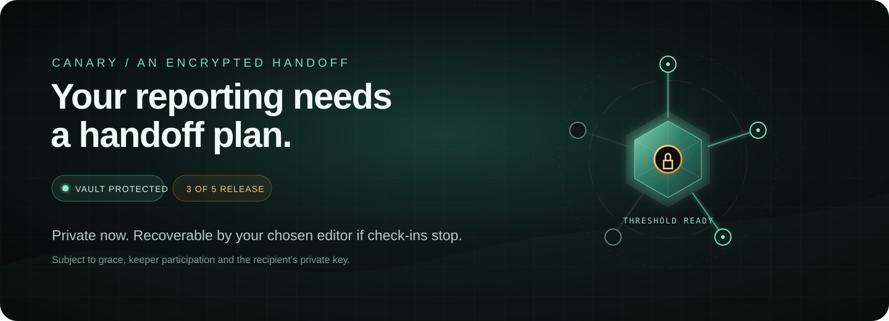
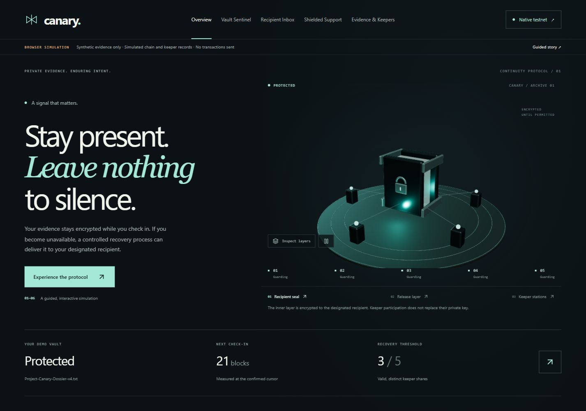
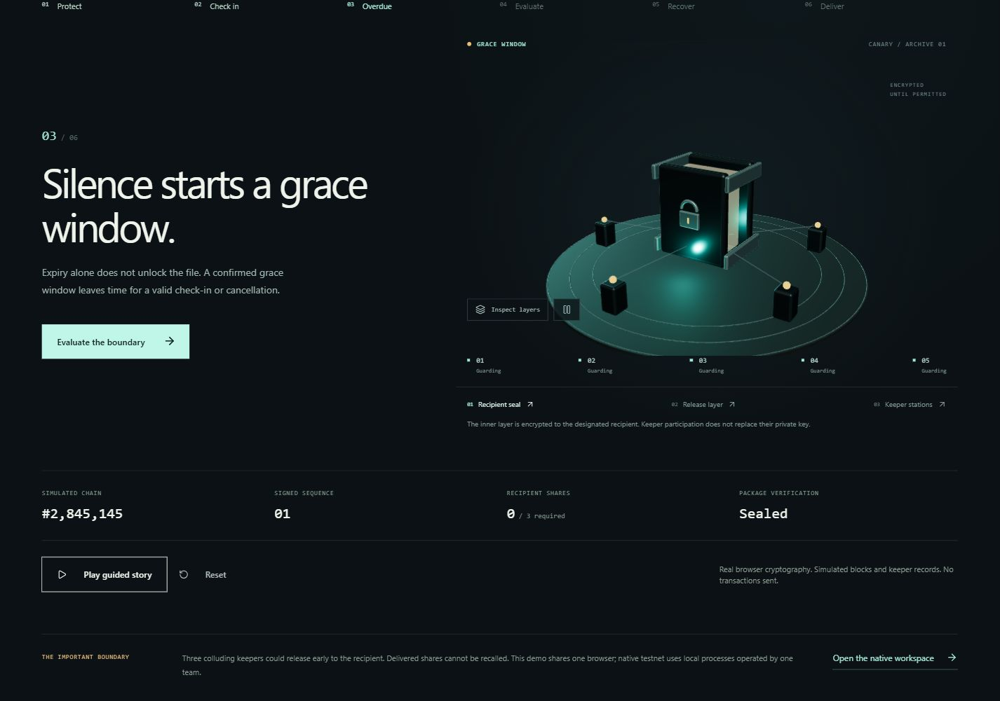
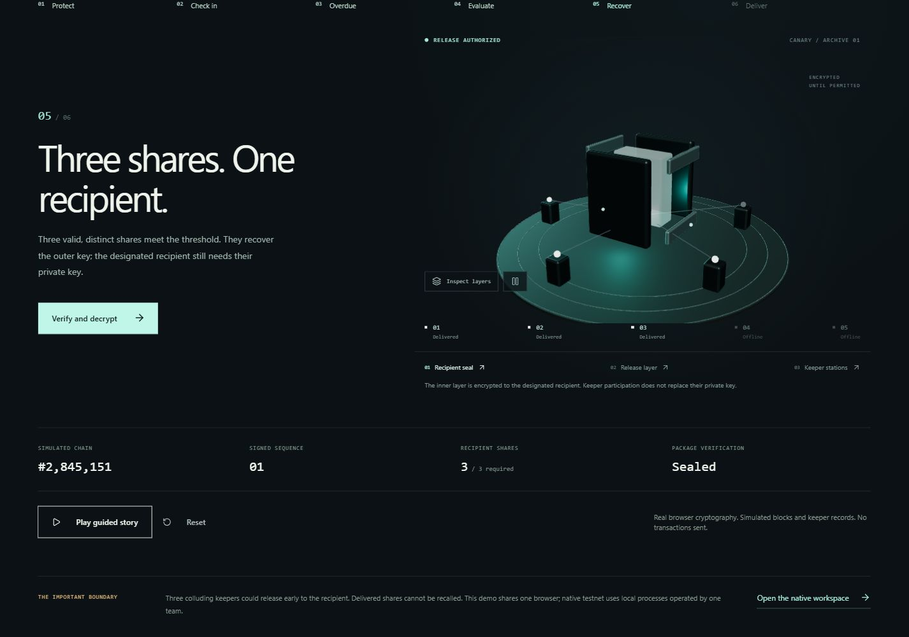
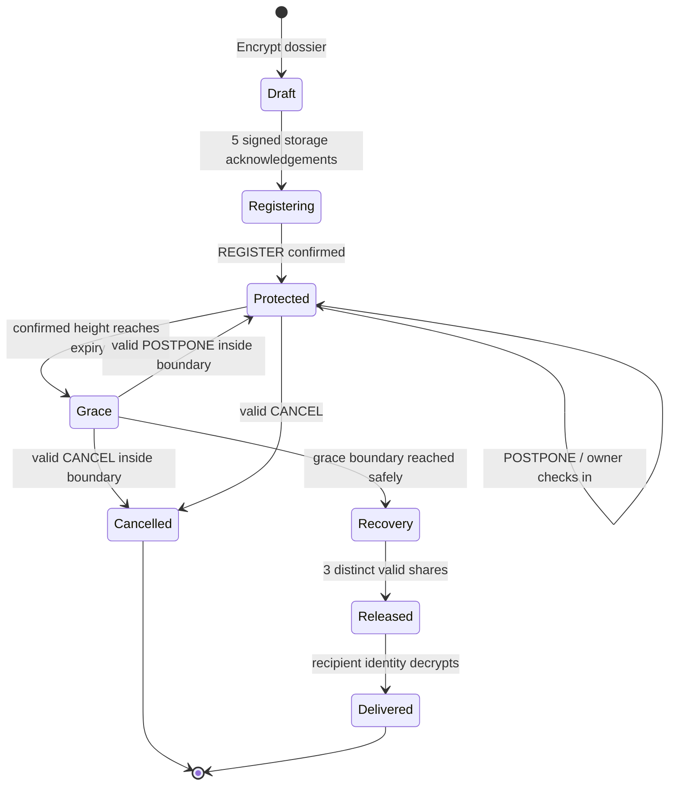
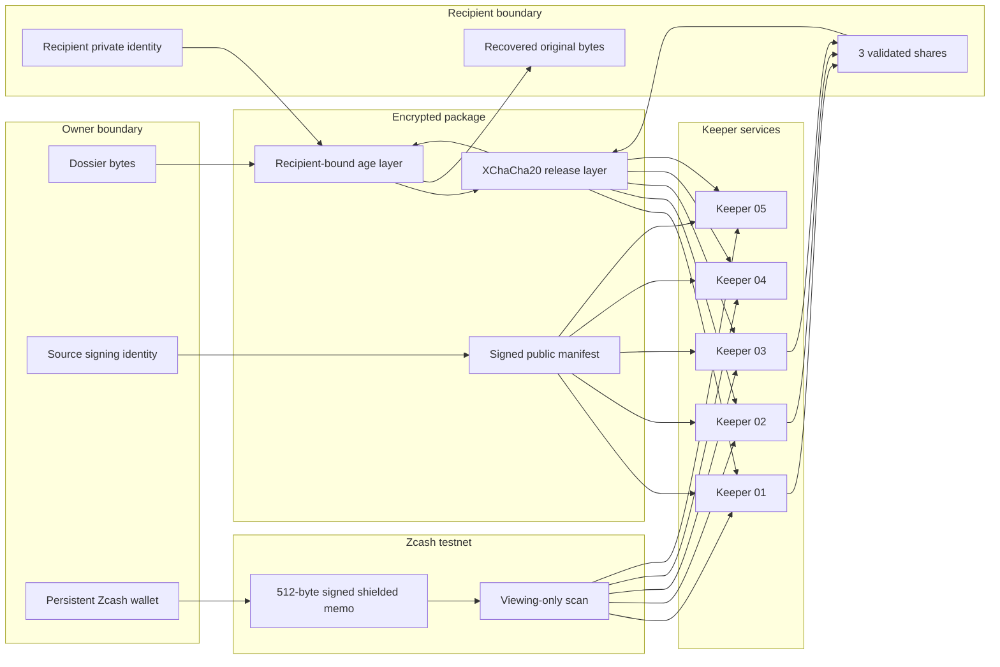

<p align="center">
  
</p>

<p align="center">
  <strong>Evidence stays encrypted while the owner is present.<br />If they become unavailable, a controlled threshold process can deliver it to their designated recipient.</strong>
</p>

<p align="center">
  
  
  
  
  
</p>

---

## The 15-second story

Canary is a privacy-preserving continuity vault. The owner encrypts a dossier for one recipient, then places the release key behind a 3-of-5 keeper threshold. A signed, shielded Zcash memo renews the deadline. If the deadline and grace window pass without a valid check-in, keepers may deliver their shares. The recipient still needs their private identity to decrypt the evidence.

The repository includes two intentionally separate experiences:

| Experience | What is real | What is simulated |
|---|---|---|
| **Guided experience** | X25519 key agreement, AES-256-GCM, Ed25519 signatures, 3-of-5 recovery, exact byte verification | Blocks, transactions, keeper records, and timing |
| **Native testnet** | Zcash testnet transactions, fixed 512-byte memos, UFVK-only scanning, age + XChaCha20-Poly1305, five persistent keeper services, SQLite state, recipient recovery | Independent organizations—the five services run under one local operator |

No smart contract is deployed. The native command channel is composed from shielded Zcash memos.

## See it

<p align="center">
  
</p>

<table>
  <tr>
    <td width="50%"></td>
    <td width="50%"></td>
  </tr>
  <tr>
    <td align="center"><sub>Deadline missed · grace window opens</sub></td>
    <td align="center"><sub>Three valid shares · recipient recovery permitted</sub></td>
  </tr>
</table>

The interface includes the pointer-reactive **Living Vault**, a six-chapter guided lifecycle, owner controls, recipient inbox, shielded support, keeper topology, evidence management, and a connected native workspace. It supports reduced motion, bounded WebGL resolution, hidden-tab pausing, and a labeled 2D fallback.

## Lifecycle



The implementation fails closed when the scanner is stale, incomplete, or detects a confirmed-chain discontinuity. It does not automatically recover a deep reorganization; an operator must resolve it.

## Architecture



### What crosses each boundary

| Boundary | Allowed | Never required there |
|---|---|---|
| Browser scene | Public lifecycle projection, keeper availability, countdown | Filenames, plaintext, private keys, share bytes, bearer token |
| Zcash chain | Signed command type, sequence, expiry, manifest commitment | Dossier bytes, filename, recipient private identity |
| Keeper | Its encrypted envelope, manifest, confirmed command stream | Recipient private identity, complete release key before threshold |
| Recipient | Encrypted package, validated release shares | Source signing key, wallet spending key |

## A real testnet proof

The completed native acceptance run used four shielded transactions and recovered the exact fixture after threshold release. Links below open in the Zcash testnet explorer.

| Action | Block | Transaction |
|---|---:|---|
| Register release-path vault | 4,546,656 | [`1d479796…19cf90ecb`](https://zexplorer.app/testnet/tx/1d4797966b97aac313b4ce7db58a4e546593c1e5efacfa992b3c73519cf90ecb) |
| Register cancellation-path vault | 4,546,660 | [`35bfb606…ecd56be0`](https://zexplorer.app/testnet/tx/35bfb606f1e822215e5827dafc6f788319d798cb96fa14f368dedcdfecd56be0) |
| Check in / postpone | 4,546,671 | [`60d30eb1…9a002f66`](https://zexplorer.app/testnet/tx/60d30eb17342311926d39c94164393d0ce9042bb3fe5e1bb3c3311d19a002f66) |
| Cancel | 4,546,677 | [`32e76a24…fbe1d865`](https://zexplorer.app/testnet/tx/32e76a242961415eee02df615778d8ab0f26427256c47bcdf258e661fbe1d865) |

All five keeper databases applied the check-in at sequence 1. The cancelled vault delivered zero shares. The release-path vault produced five validated shares and recovered the original 136-byte fixture with SHA-256 `e05e833a180c72954315c0165cf79dc921221065f65263b408bcf99ba362d2d2`.

The full reproducible record is in [docs/evidence/VERIFICATION.md](docs/evidence/VERIFICATION.md).

## Run the guided experience

Requirements: Node.js **22.12+** and npm.

```bash
git clone https://github.com/unspecifiedcoder/z-canary.git
cd z-canary
npm ci --legacy-peer-deps
npm test
npm run typecheck
npm run dev
```

Open `http://127.0.0.1:3000`, choose **Begin guided experience**, and use a synthetic file. The guide is repeatable and resettable; it never connects to a wallet or sends a transaction.

For a production bundle:

```bash
npm run build
npm run preview -- --host 127.0.0.1 --port 4174
```

## Run the local keeper rehearsal

The Rust workspace can run five actual keeper processes against a clearly labeled synthetic chain feed:

```bash
npm run demo:keepers
```

This exercises signed provisioning acknowledgements, grace-boundary cancellation, check-in during grace, restart suspension, incomplete-scan rejection, two-share failure, and exact recovery with three shares while two keepers are offline.

The backend uses Rust **1.99.0** as pinned in [backend/rust-toolchain.toml](backend/rust-toolchain.toml). To run its tests directly:

```bash
cargo +1.99.0 test --locked --manifest-path backend/Cargo.toml
```

## Run native Zcash testnet

Native mode currently targets Windows because local identities and wallet recovery use CurrentUser DPAPI. It requires PowerShell 7.2+, Rust 1.99.0, Visual C++ Build Tools, the Windows SDK, and an existing funded testnet wallet state.

First prepare the pinned upstream wallet dependency:

```powershell
pwsh -File backend/scripts/setup-wallet.ps1
```

Then start the authenticated agent and five keeper services:

```powershell
pwsh -File backend/scripts/run-native.ps1 `
  -WalletStateDir 'C:\absolute\path\to\existing-wallet-state' `
  -AllowedOrigin 'http://127.0.0.1:3000'
```

The runner prints the path of a private bearer-token file, never the token itself. Enter the token in the **Native Testnet** screen. It remains in browser memory. The runner refuses to invent or fund a replacement wallet.

Read [backend/README.md](backend/README.md) before native use. It documents the exact setup, state layout, retry behavior, key backups, API, smoke commands, and operational limits.

## Cryptographic model

### Native package

1. The source encrypts the dossier to the recipient's age/X25519 identity.
2. A fresh 256-bit release key wraps that ciphertext with XChaCha20-Poly1305.
3. `vsss-rs` splits the release key into a 3-of-5 Shamir sharing.
4. Each keeper receives a distinct, authenticated encrypted envelope.
5. The source signs the canonical manifest and every fixed-size command with Ed25519.
6. Recovery validates context, epoch, keeper identity, index, commitment, and uniqueness before interpolation.
7. The recipient uses their private age identity only after the release layer opens.

### Browser demonstration

The browser uses an intentionally separate `ZCAN-DEMO-X25519-AES256GCM-V2` format with X25519 + HKDF-SHA-256 + AES-256-GCM. Its synthetic actors and in-memory keys exist only to explain the protocol. Do not place sensitive evidence in guided mode.

## Command protocol

Every control command occupies one ZIP-302-compatible 512-byte memo. The signed body binds:

```text
domain | version | network | operation | switch_id | sequence
       | requested_expiry | manifest_digest | source_public_key
```

Supported operations are `REGISTER`, `POSTPONE`, and `CANCEL`. Sequences are monotonic. Keeper state changes only after command signature, manifest binding, chain position, confirmation target, lifecycle boundary, and scanner-health checks pass.

See [CONTRACTS.md](CONTRACTS.md) for the wire layout and [backend/CONTRACTS.md](backend/CONTRACTS.md) for the authenticated local API.

## Repository map

```text
z-canary/
├── src/
│   ├── components/       Product surfaces, Living Vault, guided story
│   ├── crypto/           Browser demonstration cryptography and memo codec
│   ├── engine/           Synthetic lifecycle model
│   ├── experience/       Public presentation projection and chapters
│   └── services/         Authenticated native-agent adapters
├── backend/
│   ├── crates/
│   │   ├── zcanary-core/            Wire protocol and canonical commands
│   │   ├── zcanary-crypto/          Native encryption and threshold sharing
│   │   ├── zcanary-storage/         Encrypted durable artifacts
│   │   ├── zcanary-keeper/          SQLite keeper state machine
│   │   ├── zcanary-keeper-service/  Isolated keeper HTTP process
│   │   ├── zcanary-agent/           Authenticated loopback API
│   │   ├── zcanary-vault-cli/       Source and recipient key boundary
│   │   └── zcanary-demo/            Repeatable process rehearsal
│   └── scripts/          Setup, launch, smoke and acceptance runners
├── wallet-gate/          Pinned Zingolib send/scan/fee harness
├── tests/                Browser crypto, lifecycle, UI-model and API tests
└── docs/evidence/        Test logs, live acceptance records and visual QA
```

## Verification snapshot

| Area | Result | Evidence |
|---|---:|---|
| Rust workspace | **66 tests passed** | [backend test log](docs/evidence/backend-tests.txt) |
| Frontend | **32 tests passed** | [frontend test log](docs/evidence/frontend-tests.tap) |
| TypeScript + Vite | **passed** | [production build log](docs/evidence/frontend-build.txt) |
| Five-process rehearsal | **12 checks passed** | [rehearsal record](docs/evidence/five-process-rehearsal.json) |
| Native live acceptance | **15 checks passed** | [testnet record](docs/evidence/native-live-acceptance.json) |
| Restart audit | **2 additional checks passed** | [restart record](docs/evidence/native-restart-audit.json) |
| Native extensions | **5 checks passed** | [extension record](docs/evidence/native-extensions.json) |
| Browser QA | desktop, tablet, mobile | [experience record](docs/EXPERIENCE.md) |
| Clean source archive | offline install/test/build passed | [clean extraction log](docs/evidence/clean-source-check.txt) |

The final main bundle is about 436 kB minified and the lazy Three.js scene about 545 kB. The scene retains Vite's chunk-size warning. No formal security audit, FPS benchmark, WCAG certification, or broad cross-browser certification is claimed.

## Threat model and honest limits

Canary demonstrates a privacy-conscious continuity protocol; it is not a production anonymity guarantee.

- Five local keeper processes share one operator, one scanner, and one lightwallet endpoint. They do not prove independent infrastructure or independent consensus.
- Any three colluding keepers can release early to the designated recipient.
- Cancellation prevents future delivery; it cannot recall shares already delivered.
- Shielded transactions protect chain-level details, but network observers and endpoint operators may still learn metadata.
- Confirmed-chain discontinuities suspend release. Automatic common-ancestor recovery is not implemented.
- Identity exports back up one encrypted identity. They do not include wallet recovery, encrypted packages, manifests, journals, or keeper databases.
- Native mode is Windows-specific today. The guided experience is portable but should contain only synthetic files.
- This code has extensive tests and live testnet evidence, but no independent security audit.

## Design and engineering notes

- [SPEC.md](SPEC.md) — system model, invariants, recovery conditions
- [TASKS.md](TASKS.md) — delivered scope and remaining deployment work
- [docs/EXPERIENCE.md](docs/EXPERIENCE.md) — visual system, motion, browser QA
- [docs/REUSE-ASSESSMENT.md](docs/REUSE-ASSESSMENT.md) — original-repository audit and competitor lessons
- [docs/WALLET-SPIKE.md](docs/WALLET-SPIKE.md) — pinned wallet transport and testnet proof
- [docs/THIRD-PARTY-NOTICES.md](docs/THIRD-PARTY-NOTICES.md) — dependency notices

## Project status

The hackathon prototype is complete and locally verified. Work still required for production includes independent keeper operation, portable full-state recovery, deep-reorg replay, deployment hardening, external review, and a final repository license decision.

The original repository contains an Apache-2.0 SPDX header in `src/App.tsx`, but no root `LICENSE` file. Confirm the intended repository-wide license before redistribution or accepting contributions.

---

<p align="center">
  <sub>Canary turns a difficult privacy and recovery protocol into a lifecycle a first-time user can see, test, and understand.</sub>
</p>
