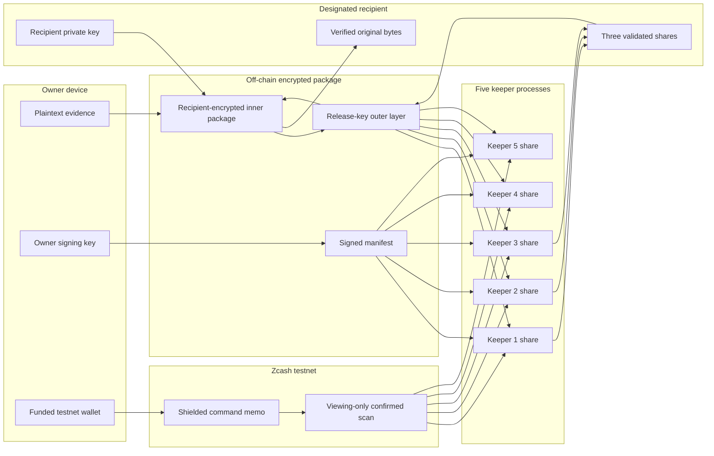
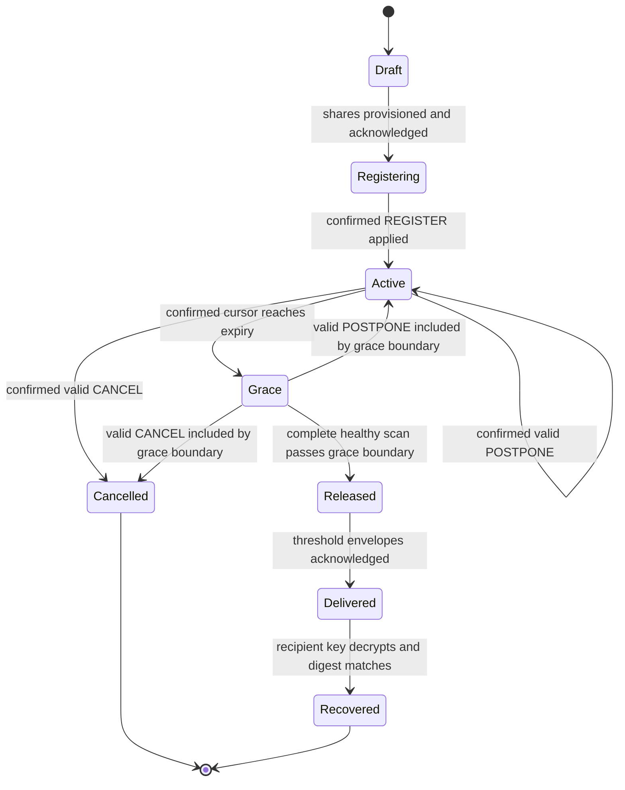

# Canary architecture

Canary is an encrypted, conditional handoff. The owner keeps checking in to keep recovery on hold. If the confirmed check-in record stops, the deadline and grace period pass, and the keeper threshold is reached, the designated recipient can recover the file with their own private key.

This document describes the implementation in this repository. It distinguishes the hosted browser demonstration from the native Zcash testnet path so that reviewers can verify the system without mistaking simulated activity for chain activity.

## Implementation ledger

| Surface | Cryptography | Blocks and commands | Keepers | Status |
|---|---|---|---|---|
| Hosted browser | Real local X25519, HKDF-SHA-256, AES-256-GCM, signatures, signed 2-through-5-of-5 sharing policy, recipient-key decryption | Simulated in memory | Simulated in one browser | Interactive educational prototype; sends no transaction |
| Five-process rehearsal | Native age/X25519, XChaCha20-Poly1305, Ed25519, 3-of-5 sharing | Explicit synthetic-chain batches | Five processes and SQLite databases under one local operator | Repeatable integration rehearsal |
| Native Zcash testnet | Same native cryptographic path, persistent local identities, signed 512-byte commands | Real shielded testnet transactions recovered by a viewing-only scanner | Five local processes sharing one scanner and lightwallet endpoint | Recorded end-to-end acceptance; not independent infrastructure |
| Production deployment | Not implemented | Not implemented | Independent operators not deployed | Requires security review and operational work |

## Why Zcash is not decorative

The protected file never goes on-chain. In native mode, Zcash is the private, ordered command channel for the owner's intent:

- `REGISTER` binds a vault to its signed manifest and initial expiry.
- `POSTPONE` is a signed check-in that requests a later expiry.
- `CANCEL` stops future release when it is valid and processed before release.

Each command is a fixed 512-byte ZIP-302-compatible shielded memo. A viewing-only scanner recovers confirmed memo events for keepers without holding spending authority. Removing Zcash from this design would remove the demonstrated shielded transport and confirmed ordering for those control commands; the off-chain cryptography and keeper policy would still need a different authenticated event source.

Zcash use does **not** prove complete network anonymity. Lightwallet operators and network observers can learn metadata, and the current local scanner and keeper deployment are centralized operationally.

## End-to-end data flow



The diagram shows logical roles. In the recorded native run, all five keeper processes and the scanner ran under one operator; it does not claim five independent organizations.

## Where data lives

| Location | Present | Absent by design |
|---|---|---|
| Zcash shielded memo | Operation, switch ID, sequence, requested expiry, manifest digest, owner public key, signature | File bytes, filename, recipient private key, keeper shares |
| Signed public manifest | Network and switch, owner and recipient public keys, package digest and size, interval/grace/confirmation policy, maximum extension, keeper IDs, threshold, epoch, share commitments | Plaintext, filename, private keys |
| Keeper database | Its encrypted share envelope, manifest-bound state, ordered confirmed command result, delivery outbox | Recipient private key; other keepers' plaintext shares |
| Recipient workflow | Encrypted package and validated recipient-bound delivery envelopes | Owner signing key and wallet spending key |
| Hosted presentation state | Public lifecycle projection and synthetic test identities | Native private keys, bearer token, native plaintext, native share bytes |

## Cryptographic construction

### Native path

1. The owner encrypts the file to the recipient's age/X25519 identity.
2. A fresh 256-bit release key wraps that ciphertext with XChaCha20-Poly1305.
3. `vsss-rs` splits the release key into a 3-of-5 Shamir sharing.
4. Each keeper receives a distinct authenticated encrypted envelope and returns a signed provisioning acknowledgement.
5. The owner signs the canonical manifest and every control command with Ed25519.
6. Recovery checks switch, epoch, keeper identity, share index, manifest commitment, uniqueness, and threshold before interpolation.
7. Opening the release layer is insufficient by itself: the recipient's age private identity must open the inner package.

### Browser demonstration

The browser deliberately uses a separate `ZCAN-DEMO-X25519-AES256GCM-V2` format: X25519, HKDF-SHA-256, AES-256-GCM, signatures, and a signed configurable threshold from 2-of-5 through 5-of-5. It exists to make the lifecycle testable without a funded wallet. Its blocks, transactions, time, and keeper records are simulated and resettable. The native implementation and recorded acceptance run remain fixed at 3-of-5.

Neither path is presented as independently audited cryptography.

## Command authentication and replay handling

The signed command body binds:

```text
domain | version | network | operation | switch_id | sequence
       | requested_expiry | manifest_digest | source_public_key
```

Important checks:

- `REGISTER` must use sequence `0`.
- `POSTPONE` and `CANCEL` must use a positive sequence strictly greater than the last applied sequence.
- The signature, network, switch, source key, and manifest digest must match.
- `CANCEL` must request expiry `0`.
- A postponement must move expiry forward and stay within the signed maximum-extension policy measured from its inclusion height.
- Confirmed events are processed in canonical block, transaction, and output order.
- A durable wallet journal binds retry to the same memo digest; an ambiguous send is not blindly repeated.

The exact layout and validation rules are in [`CONTRACTS.md`](../CONTRACTS.md).

## Confirmation, grace, and release state machine



The confirmed scan endpoint is `tip - confirmation_target + 1`. Keepers process all commands included through the inclusive grace boundary before permitting release. A late command cannot revive an already expired switch.

`REGISTERING` is an application operation state. Keeper state remains `DRAFT` until a valid confirmed registration has been applied.

## Scanner health, restarts, and reorganizations

Release fails closed when the scanner cannot provide a fresh, complete, contiguous confirmed batch. Malformed input, missing blocks, a checkpoint mismatch, an unexpected block-hash link, or stale scanning suspends delivery.

Keepers also start suspended after restart. They require a new verified complete scan before dispatching a pending delivery.

A detected confirmed-chain discontinuity latches a reorganization incident and prevents delivery. Automatic common-ancestor discovery and replay are **not implemented**. Operator intervention is required. Shares already delivered cannot be recalled.

## Recipient binding and threshold

The signed manifest binds the recipient public key, fingerprint, and threshold policy. Keeper delivery envelopes bind the manifest digest and recipient. Recovery rejects duplicate, malformed, mismatched, or uncommitted shares—including invalid extra shares supplied beyond the threshold. The signed number of distinct valid shares reconstructs only the outer release key; a different recipient private key still cannot open the inner package. The public Maya/Noor example and native path use 3-of-5.

The threshold limits a single keeper, but it is not a magic decentralization guarantee. Three colluding keepers can release early to the designated recipient. The current five local processes also share one operator and scanner.

## What has been demonstrated

- Four confirmed native testnet commands for two vaults: two registrations, one postponement, and one cancellation.
- Five signed keeper provisioning acknowledgements per native vault.
- All five keeper databases applying postponement sequence `1`.
- Zero delivered shares for the cancelled path.
- Five delivered shares for the expiry path.
- Exact recovery of the 136-byte native fixture with matching SHA-256.
- Restart persistence of the terminal cancelled and released states.
- Synthetic five-process coverage for two-share failure, three-share success with two keepers offline, inclusive-boundary cancellation, stale/incomplete scans, and restart suspension.
- Browser coverage for early refusal, check-in, grace, stale scan, threshold, wrong recipient, reset, and exact 500-byte download.

Start with the [`verification record`](evidence/VERIFICATION.md), then inspect the machine-readable files in [`docs/evidence`](evidence/).

## What is not demonstrated

- Independent keeper organizations or independent chain-consensus sources.
- Automatic deep-reorganization recovery.
- A hosted wallet connection or hosted real-transaction flow.
- Automatic delivery by email, messaging service, or publication system.
- Protection after the local owner or recipient device is fully compromised.
- Complete disaster recovery for wallets, packages, journals, and databases.
- Mainnet deployment, smart contracts, anonymity guarantees, security audit, or production readiness.

See the [`threat model`](THREAT-MODEL.md) for the consequences of those limits.

## Code map

| Concern | Implementation |
|---|---|
| Memo and manifest contracts | [`CONTRACTS.md`](../CONTRACTS.md), [`zcanary-core`](../backend/crates/zcanary-core/) |
| Browser cryptography and lifecycle | [`src/crypto`](../src/crypto/), [`protocolStore.ts`](../src/engine/protocolStore.ts) |
| Native encryption and sharing | [`zcanary-crypto`](../backend/crates/zcanary-crypto/) |
| Keeper reducer and durable outbox | [`zcanary-keeper`](../backend/crates/zcanary-keeper/) |
| Keeper HTTP isolation | [`zcanary-keeper-service`](../backend/crates/zcanary-keeper-service/) |
| Native loopback API | [`zcanary-agent`](../backend/crates/zcanary-agent/) |
| Source and recipient boundary | [`zcanary-vault-cli`](../backend/crates/zcanary-vault-cli/) |
| Wallet send and viewing-only scan | [`wallet-gate`](../wallet-gate/) |

