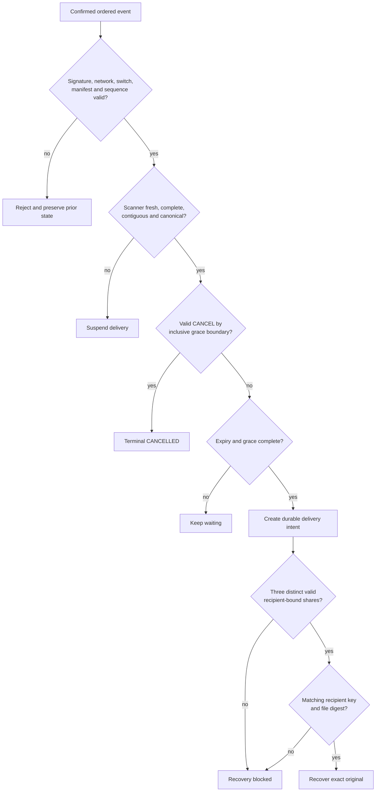

# Canary threat model

This is a threat model for the current prototype, not a security certification. Canary has not received an independent audit and must not be used for genuine whistleblower evidence.

## Security objective

While the owner continues valid check-ins, the evidence should remain unavailable through the normal recovery path. If confirmed check-ins stop, the signed timing policy completes, and enough keepers participate, the designated recipient—not an arbitrary observer—should be able to recover the exact original bytes.

Canary does not determine whether a person is safe, missing, detained, or dead. It evaluates an authenticated command record against a policy chosen earlier.

## Assets

- Plaintext evidence and filename
- Owner signing identity
- Recipient private identity
- Wallet spending and viewing capabilities
- Release key and keeper shares
- Signed manifest and command journal
- Encrypted package
- Keeper databases and delivery outboxes
- Integrity and availability of the confirmed-chain scan

## Actors and current trust assumptions

| Actor | Trusted for | Not trusted or not proven for |
|---|---|---|
| Owner device | Creating the intended file, recipient, and timing policy; protecting its local keys | Remaining uncompromised by malware or physical seizure |
| Recipient | Protecting the recipient private identity and checking the recovered digest | Keeping recovered plaintext secret after release |
| Individual keeper | Validating its policy and protecting its share | Resisting collusion with two other keepers |
| Keeper set | Requiring three distinct valid shares | Organizational independence in the recorded run |
| Viewing-only scanner | Supplying complete, ordered, confirmed chain data | Independent consensus; the current keepers share one scanner and endpoint |
| Zcash network | Providing the demonstrated shielded transaction transport and chain ordering | Hiding every form of network metadata or preventing all reorganizations |
| Local operator | Running the native demo and preserving state | Being an acceptable production trust root |

## Threat analysis

| Threat | Current control | Residual risk / honest limit |
|---|---|---|
| File leaks before release | Recipient encryption inside a release-key layer; plaintext remains off-chain | A compromised owner device can read plaintext before encryption; a compromised recipient can disclose after recovery |
| One keeper releases early | 3-of-5 Shamir threshold; share commitments and keeper/index validation | Three colluding keepers can release early to the designated recipient |
| Wrong recipient obtains the shares | Signed manifest binds recipient key; inner age/X25519 layer still requires matching private identity | Loss or theft of the recipient private key defeats this boundary |
| Duplicate or replayed command | Monotonic sequence and signature/manifest/switch/network binding | Correctness still depends on durable state and a complete ordered scan |
| Out-of-order or duplicated chain event | Canonical block/transaction/output ordering and duplicate-position rejection | A malicious or faulty common scanner remains a shared dependency |
| Unconfirmed event changes policy | Keeper reducer consumes confirmed batches using the manifest's target | The selected confirmation target may be inadequate for every network condition |
| Reorganization or broken hash linkage | Discontinuity latches an incident; release is suspended | Automatic ancestor search and replay are unfinished; operator intervention is required |
| Stale or incomplete scan causes release | Missing, malformed, unavailable, stale, or incomplete input suspends delivery | Availability can be denied by scanner or network failure |
| Keeper restarts just before release | Restart begins suspended and requires a fresh complete scan | State loss or operator mistakes can still block recovery |
| Cancellation races release | Commands through the inclusive grace boundary are processed before release | Cancellation cannot recall shares already delivered; a late cancellation cannot revive a released switch |
| Ambiguous wallet send is repeated | Durable memo-digest journal; ambiguous broadcast is not blindly retried | Manual deletion or corruption of wallet state can break this protection |
| Share substitution or malformed extras | Commitment, context, epoch, keeper, index, length, uniqueness, and recipient-envelope checks | Implementation is unaudited; side-channel resistance is not claimed |
| Single local operator compromises all five processes | Process and database separation exercise interfaces and persistence | It is not organizational decentralization; an operator compromise can affect the entire recorded deployment |
| Hosted demo is mistaken for live chain behavior | UI and documentation label browser blocks, time, keepers, and transactions as simulated | Any unlabeled screenshot or edited film can still mislead; presentation must retain the disclosure |
| Metadata reveals sensitive relationships | File and filename stay off-chain; commands use shielded memos | Timing, endpoints, traffic patterns, funding, and lightwallet access may reveal metadata; anonymity is not guaranteed |
| Key or state loss makes recovery impossible | Passphrase-encrypted source/recipient identity export and persistent encrypted state | Identity export is not full disaster recovery; wallet, package, journals, keeper DBs, and receipts need separate preservation |
| Malicious web origin calls native agent | Loopback-only listener, exact origin allowlist, bearer authentication, bounded request bodies | Malware under the same user account or token theft is outside the browser-origin boundary |
| Denial of service | Fail-closed scanning and multiple keeper processes | The design prioritizes preventing premature release; it cannot guarantee timely recovery under outage or censorship |

## State-transition safety rules

Terminal state is important: cancellation and release are not reversible lifecycle animations. Once a share has been delivered, a later cancellation cannot make the recipient forget it.

## Browser, rehearsal, and native evidence

| Claim | Browser | Five-process rehearsal | Native testnet acceptance |
|---|---:|---:|---:|
| Local encryption/decryption | Yes | Yes | Yes |
| Signed command validation | Yes | Yes | Yes |
| Threshold reconstruction | Yes | Yes | Yes |
| Real keeper processes/databases | No | Yes | Yes |
| Real Zcash transactions | No | No | Yes |
| Independent keeper operators | No | No | No |
| Independent security audit | No | No | No |

Evidence is indexed in [`VERIFICATION.md`](evidence/VERIFICATION.md). A source file, compiled binary, passing test, or recorded transaction is evidence of that specific behavior—not proof that the complete system is secure.

## Production blockers

The following are release blockers for use with real sensitive material:

1. Independent cryptographic and application security review.
2. Independently operated keepers using separate chain-data sources and documented service policy.
3. Implemented and tested reorganization recovery rather than a latched manual incident.
4. End-to-end backup and disaster recovery for wallet state, packages, journals, identities, keeper databases, and delivery receipts.
5. Recipient onboarding and authenticated delivery that does not place both roles on one machine.
6. Operational monitoring, incident response, upgrades, and secure key rotation.
7. Privacy analysis covering network, funding, lightwallet, timing, and endpoint metadata.
8. Adversarial testing for collusion, malformed inputs, compromised services, resource exhaustion, and rollback.
9. Clear retention, deletion, legal, and abuse-handling policies.
10. Usability testing with the intended organizations under realistic failure conditions.

## Safe evaluation guidance

- Use only fictional or public test files.
- Use the hosted flow to evaluate UX and lifecycle behavior, not chain execution.
- Use the linked testnet transactions and native acceptance record to verify the implemented Zcash path.
- Never enter a mainnet seed phrase or sensitive private key.
- Do not treat a successful demo as authorization to protect real evidence.

## Verification map

- [Wire contract](../CONTRACTS.md)
- [Native runtime and operational limits](../backend/README.md)
- [End-to-end verification record](evidence/VERIFICATION.md)
- [Native live acceptance](evidence/native-live-acceptance.json)
- [Keeper database inspection](evidence/live-postpone-databases.json)
- [Five-process rehearsal](evidence/five-process-rehearsal.json)
- [Restart audit](evidence/native-restart-audit.json)
- [Browser case-study tests](../tests/caseStudy.test.ts)

